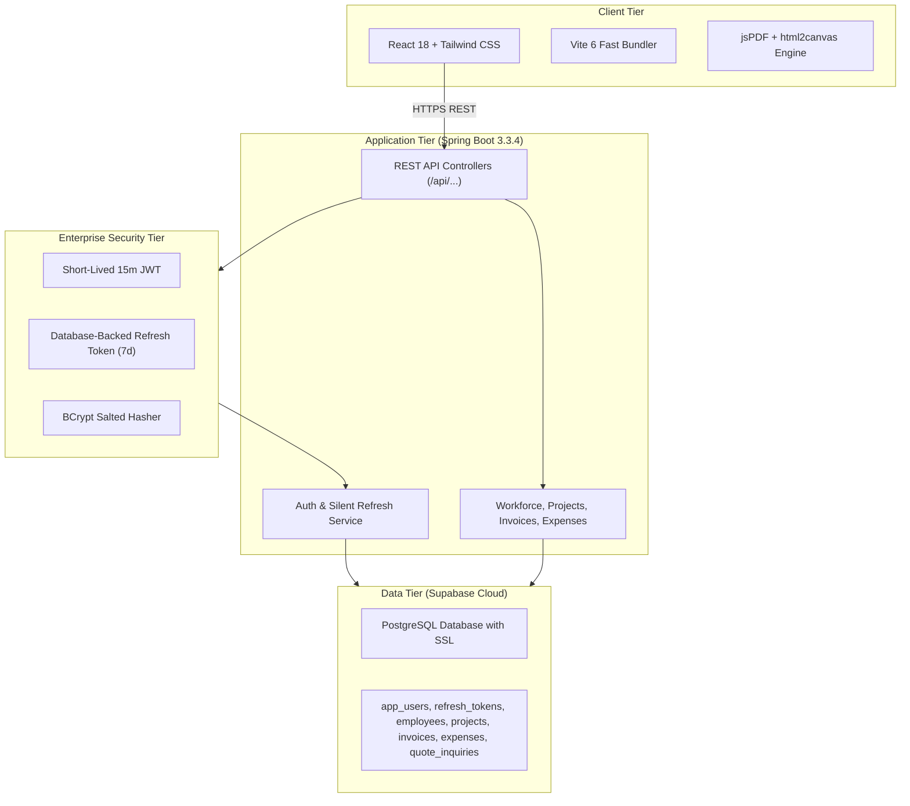

# 🌲 Vishwakarma Woods Work & Enterprises — Digital Hub

> A high-performance, dual-purpose digital ecosystem combining an authentic public-facing showcase with an enterprise internal management portal for architectural millwork, custom carpentry, and interior contracting.

[](https://react.dev/)
[](https://spring.io/projects/spring-boot)
[](https://www.oracle.com/java/)
[](https://supabase.com/)
[](https://tailwindcss.com/)
[](#)

---

## 📌 Executive Summary

**Vishwakarma Woods Work & Enterprises** is an end-to-end management platform built specifically for craftsman contractors, interior developers, and bespoke carpentry businesses. It replaces fragmented paper estimates, WhatsApp job tracking, and spreadsheet timesheets with an integrated system that connects public client acquisition directly to on-site project execution.

### Multi-Company Entity Support
The platform seamlessly handles two legal operating entities with dynamic tax identifiers, registration details, and official letterheads:
* **Vishwakarma Woods Work** — GST: `27APHPV6529H1ZC` | PAN: `APHPV6529H` | Pune, MH
* **Vishwakarma Enterprises** — GST: `27AWUPV4157F1ZT` | PAN: `AWUPV4157F` | SAC: `995476` | Pune, MH

---

## ✨ Key System Features

### 1. 🌐 Public Client Experience & Portfolio
* **Craftsman Monogram & Design:** Built with a dual-mode theme engine (**Dark Mode** / **Light Warm Woodcraft**).
* **Interactive Cost Estimator & Quote Calculator:** Prospective clients adjust square footage, room types, and material finishes (Commercial Ply, BWP Marine 710, Teak Wood, Acrylic PU) to generate estimated budget ranges.
* **Instant Lead Capture:** Quote submissions directly pipe into the contractor's internal inbox.
* **Filterable Completed Site Portfolio:** Showcase finished luxury kitchens, wardrobes, and living room millwork with verified client reviews.
* **1-Click WhatsApp Engagement:** Connects customers straight to the master craftsman's phone with pre-filled inquiries.

### 2. 🔐 Enterprise Security Architecture
* **Spring Security 3.3 + BCrypt:** Salted cryptographic password protection for admin accounts.
* **15-Minute Short-Lived Access Tokens (JWT):** Hardened token validity to minimize attack windows.
* **Database-Backed Refresh Token Rotation:** 7-day UUID cryptographic refresh tokens stored in Supabase with automatic single-token enforcement.
* **Silent Refresh & 401 Interception Loop:** Frictionless user session continuation via `/api/auth/refresh` without prompting passwords again.
* **Physical Logout Revocation:** Explicit token purge from database upon logout, preventing token reuse.
* **Storage Hardening:** Session memory resides in `sessionStorage` (auto-cleared the instant the browser tab closes).

### 3. 🛠️ Master Contractor Management Portal (`/#admin`)
* **Workforce & Master Carpenters:** Track carpenter profiles, trade designations (Master Joiner, PU Polisher, CNC Specialist), payment frequency (daily wage / monthly), and active site deployments.
* **Project Lifecycle Board:** Monitor jobs from site measurement, factory cutting, and carcase assembly to final handover.
* **Milestone Invoicing & Cash Flow:** Structured payment stages (30% advance, 50% fabrication, final settlement) with balance tracking.
* **Material Expenses & Net Profit Margin Engine:** Log purchases for plywood, veneers, laminates, and hardware (Hettich / Hafele) to calculate real net contractor margins per job site.
* **Quotes Inbox:** Manage all prospective client inquiries with direct review and status assignment.

### 4. 🖨️ Official Letterhead Quotation & Site Inspection PDF Generator
* **Pixel-Accurate Scanned Document Matching:** Reconstructed letterhead typography matching physical documents (`॥ श्री ॥`, single-line Bold Roman Serif company title, tax rows, solid black rule).
* **Multi-Company Toggle:** 1-Click switching between *Vishwakarma Woods Work* and *Vishwakarma Enterprises*.
* **Custom Numbering Switcher:** Official `01.` (two-digit dot default), `1.`, `1}` (bracket), `I.` (Roman uppercase), and `•` (bullet) styles.
* **Digital Signature Suite:**
  * Interactive canvas pad with blue/black ink selector.
  * Signature image/scan upload (PNG/JPG).
  * Formal cursive calligraphy rendering.
  * Blank mode for physical ballpoint pen signing.
* **1-Click 300-DPI A4 Export:** High-resolution PDF generation with automated naming (`Vishwakarma_Quotation_[Site]_[Date].pdf`).

---

## 🏛️ Architecture & Tech Stack



### Technology Breakdown
| Layer | Technologies Used |
| :--- | :--- |
| **Frontend** | React 18, Vite 6, Tailwind CSS, Lucide Icons, html2canvas, jsPDF |
| **Backend** | Java 21, Spring Boot 3.3.4, Spring Security, Spring Data JPA, JJWT 0.12.5 |
| **Database** | PostgreSQL 15 on Supabase Cloud (with SSL encryption) |
| **DevOps & Containers** | Docker (Eclipse Temurin 21 Alpine), Docker Compose, Maven 3.8 |
| **Hosting Targets** | Vercel (Frontend Global CDN) + Render (Backend Web Service) |

---

## 🚀 Getting Started Locally

### Prerequisites
* **Java 21 JDK** or newer
* **Node.js 18+** & npm
* **Maven 3.8+** (or use included wrapper)

### 1. Backend Setup
```bash
cd backend
mvn clean spring-boot:run
```
* Backend starts at `http://localhost:8080/api`
* Health check: `http://localhost:8080/api/health`

### 2. Frontend Setup
```bash
cd frontend
npm install
npm run dev
```
* Frontend starts at `http://localhost:5173`
* Admin portal: `http://localhost:5173/#admin`

---

## 👤 Default Admin Credentials
* **Username / Email:** `contractor@vishwakarmawoods.com`
* **Password:** Configured via `INITIAL_ADMIN_PASSWORD` environment variable (set securely in your deployment settings)

---

## 📄 License & Intellectual Property
Developed exclusively for **Vishwakarma Woods Work** & **Vishwakarma Enterprises**. All rights reserved.
